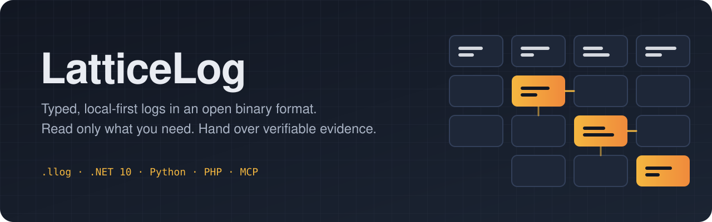
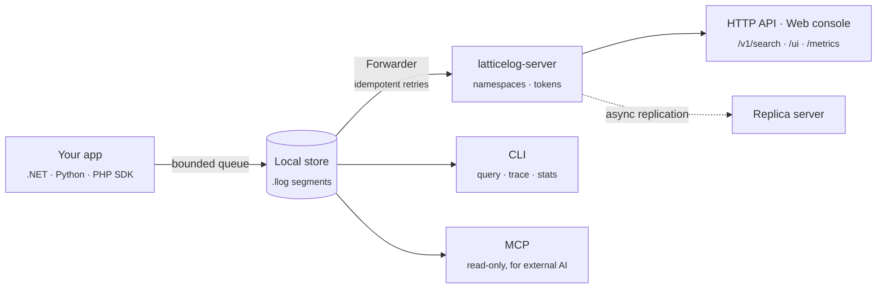

<div align="center">



<h1>LatticeLog</h1>

<p><strong>Typed, local-first logs in an open binary format. Read only what you need, and hand over evidence anyone can verify.</strong></p>

[](https://github.com/lreyesm1999/LatticeLog/actions/workflows/ci.yml)
[](https://dotnet.microsoft.com/)
[](sdks/python)
[](sdks/php)
[](ROADMAP.md)
[](LICENSE)

<p>
  <a href="#quick-start">Quick Start</a> ·
  <a href="#try-it-on-demo-data">Demo</a> ·
  <a href="#how-it-works">How It Works</a> ·
  <a href="#capabilities">Capabilities</a> ·
  <a href="#measured-results">Results</a> ·
  <a href="#project-status">Status</a> ·
  <a href="#documentation">Docs</a>
</p>

</div>

---

**LatticeLog** is a log and event engine for .NET 10. Your application writes **typed events** with very low overhead. They go to an **open binary format (`.llog`)** on local disk that rebuilds every event exactly as it was written. Queries use **indexes** to skip everything they don't need, and the engine produces **deterministic evidence** for whoever reads next: a person, a script or an external AI.

> [!NOTE]
> **LatticeLog runs no AI.** It structures, filters, groups and retrieves. Interpreting the result is up to the reader, and every answer points back to the exact records it came from.

<table>
  <tr>
    <td width="33%"><strong>1. Capture with types</strong><br>Events declared once, generated at compile time. A <code>long</code> stays a <code>long</code>. 56 ns per event on the hot path.</td>
    <td width="33%"><strong>2. Store in the open</strong><br>Append-only <code>.llog</code> segments with per-block CRCs, crash recovery, and an independent Python reader that proves the spec.</td>
    <td width="33%"><strong>3. Read precisely</strong><br>Indexes skip blocks that cannot match. Every answer says what it covered and whether anything is missing.</td>
  </tr>
</table>

---

## The Problem It Solves

| Plain-text / JSON logs | LatticeLog |
|---|---|
| `42`, `"42"` and `42.0` all end up as text; searching means `grep` and regexes. | Every attribute keeps its type: `long`, `decimal`, UUID, timestamp, bytes, maps. |
| The same JSON keys are repeated millions of times; filtering one hour of errors means decompressing and parsing everything. | Columnar blocks with a key catalog; time/severity/service/trace indexes skip whole blocks. |
| Results are silently truncated, sampled or incomplete. | Each response states its **coverage**: segments scanned, partial or not and why, storage issues found. |
| Handing context to a teammate or an AI means copy-pasting fragments. | **Context Packs** and an **MCP server** that finds logs **by service name**, with references back to every source record. |
| Retries can duplicate or lose data. | Each record carries `(producer, sequence)`: retries are idempotent, and an ACK reports the durability actually reached. |
| Your data is locked into a vendor's storage. | Documented format, independent reader, and a lossless export to `latticelog.jsonl` or OTLP. |

### Is it a good fit?

| Good fit today | Not a fit yet |
|---|---|
| .NET services that want typed, structured events without a logging backend | Workloads that need a cluster, sharding or object-storage tiers |
| Edge, desktop or on-prem apps that must keep logs locally and survive crashes | Environments that require encryption at rest or an external security audit |
| Teams that hand incident evidence to people, scripts or AI tools and need it to be traceable | Anyone who needs packages from NuGet, PyPI or Packagist today |

---

## Quick Start

> [!IMPORTANT]
> Packages are not on NuGet, PyPI or Packagist yet, so you build from source. You need the [.NET 10 SDK](https://dotnet.microsoft.com/download) (the exact version is pinned in [`global.json`](global.json)).

```bash
git clone https://github.com/lreyesm1999/LatticeLog.git
cd LatticeLog
dotnet build LatticeLog.sln -c Release
```

### 1. Reference LatticeLog from your app

Add two project references. The second one runs the source generator that turns `[LatticeEvent]` declarations into code; it is not needed until step 4.

```xml
<!-- YourApp.csproj -->
<ItemGroup>
  <ProjectReference Include="path/to/LatticeLog/src/LatticeLog.Core/LatticeLog.Core.csproj" />
  <ProjectReference Include="path/to/LatticeLog/src/LatticeLog.Generator/LatticeLog.Generator.csproj"
                    OutputItemType="Analyzer" ReferenceOutputAssembly="false" />
</ItemGroup>
```

### 2. Write your first event

```csharp
using LatticeLog;
using LatticeLog.Core;

using var logger = LatticeLogger.CreateLocal("./logs");
logger.Info("Hello, LatticeLog");
```

### 3. Read it back

The `.llog` file is binary, so you read it through a tool rather than a text editor. Install the `latticelog` CLI as a .NET tool from a locally built package:

```bash
dotnet pack src/LatticeLog.Cli -c Release -o ./nupkg
dotnet tool install --global LatticeLog.Cli --add-source ./nupkg --prerelease
```

```bash
latticelog tail ./logs
```

```text
2026-11-19T03:17:49.539769700Z INFO  Hello, LatticeLog #1
```

The `#1` at the end is the record's sequence number. To run the CLI without installing it, use `dotnet run --project src/LatticeLog.Cli -- tail ./logs`.

### 4. Go typed

Declare an event once. The source generator writes the method at compile time, so there is no reflection and no string formatting on the hot path:

```csharp
using var logger = LatticeLogger.CreateLocal("./logs", o =>
{
    o.Durability = DurabilityMode.Balanced;              // Fast | Balanced | Durable
    o.Resource.Add(new("service.name", "orders-api"));
});

using (logger.BeginOperation("PlaceOrder", "order-991"))
    AppEvents.StockTimeout(logger, productId: 42, elapsedMs: 12_000);

var ack = await logger.FlushAsync(AckLevel.FsyncConfirmed);
Console.WriteLine(ack.Level);                            // the level actually reached, not the one requested

static partial class AppEvents
{
    [LatticeEvent(Id = 2101, Name = "inventory.stock.timeout", Level = Severity.Error,
                  Message = "Stock query for {productId} timed out after {elapsedMs} ms")]
    public static partial void StockTimeout(ILatticeLogger logger, long productId, int elapsedMs);
}
```

```bash
latticelog query ./logs --where "level >= ERROR AND service = 'orders-api'"
```

```text
2026-11-19T03:17:49.541620100Z ERROR [orders-api] inventory.stock.timeout: Stock query for 42 timed out after 12000 ms productId=42 elapsedMs=12000 #2
-- 1 event(s); scanned 1/1 segments, 2 records decoded in 14.5 ms
```

`productId` is stored as a 64-bit integer and `elapsedMs` as a 32-bit one, not as text, so `attr.productId = 42` is an exact typed comparison.

### Already using `ILogger`?

Keep your code: reference `src/LatticeLog.Extensions.Logging` as well and register the bridge.

```csharp
builder.Logging.AddLatticeLog(LatticeLogger.CreateLocal("./logs"));
```

### Python services, old log files and your AI tools

A Python service writes LatticeLog's own format into its own folder, with no server: one line for the folder and one
for structlog ([`sdks/python`](sdks/python)).

```python
log = latticelog.open("logs/orders-api", service="orders-api", environment="dev")
structlog.configure(processors=[..., latticelog.structlog_processor(log), structlog.dev.ConsoleRenderer()])
```

Register the folder that holds your services once (or list them in a project [`latticelog.toml`](specs/local-sources.md#project-file-latticelogtoml-optional)),
connect your AI client, and ask about a service **by name**: no paths, no formats.

```bash
latticelog roots add ./logs                      # per-user; .NET stores under it are found too
latticelog mcp install --client claude-code      # or claude-desktop, cursor, vscode (asks before overwriting)
latticelog sources                               # orders-api  python-local  12,840 records ...
```

Old text or JSON logs are converted only when you ask (the MCP tools `preview_migration` and `migrate_logs`, or the
CLI). The originals are never modified, moved or deleted; re-running imports only new lines.

```bash
latticelog allow add D:/old-service/logs
latticelog migrate "D:/old-service/logs/app.log*" --name legacy-app   # 378 MB structlog file -> 7.9 MB, 1,762,702 records
```

The whole flow, scripted end to end: [`examples/developer-flow`](examples/developer-flow). To have it all start with
your session and serve every editor from one background process, see [Install once](#install-once).

---

## Install once

Like Redis or Ollama: install one file per user, connect your AI tools once, and from then on every service that
writes LatticeLog format into its folder can be asked about **by name**. No .NET, no administrator rights, nothing
system-wide, and nothing listens beyond `127.0.0.1`.

**Windows (PowerShell).** Build the single-file executable once, or take `latticelog.exe` from the `latticelog-win-x64`
CI artifact, then run `setup`. Building needs the .NET 10 SDK and Visual Studio 2022 Build Tools with *Desktop
development with C++* (the native linker). Running needs neither.

```powershell
pwsh scripts/publish-aot.ps1                        # -> artifacts\aot\win-x64\latticelog.exe (Native AOT, one file)
.\artifacts\aot\win-x64\latticelog.exe setup        # asks which MCP clients to configure
# without questions: latticelog.exe setup --clients claude-desktop,claude-code --yes
```

**Linux / macOS.** Run `sh scripts/install.sh --build`, which needs the .NET 10 SDK plus clang (or the Xcode command
line tools), or `sh scripts/install.sh ./latticelog` with a prebuilt binary.

`setup` does three things and prints each one:

1. **Copies the executable** to `%LOCALAPPDATA%\Programs\LatticeLog` (Linux/macOS: `~/.local/bin`) and adds that
   folder to your user `PATH`.
2. **Registers and starts the background service** for your user. On Windows it is a Task Scheduler task at logon (or
   `--method run-key`); on Linux a systemd user unit; on macOS a launchd agent. The service owns the source catalog:
   - indexes Python sources incrementally;
   - follows migrations made with `follow=true`;
   - compacts and applies retention to LatticeLog's own copies, never to your original files;
   - serves every MCP client from one process, so several editors at once never contend for an index.
3. **Adds a `latticelog` MCP server entry** to the clients you pick: Claude Desktop, Claude Code, Cursor, VS Code.
   Existing config files are backed up first, and an existing entry is replaced only after you confirm.

Then register the folder your services write into, and ask:

```bash
latticelog roots add C:/dev/my-services/logs   # once; services under it are found by name
latticelog service status                      # sources, last indexed time, disk use, errors
llog ui                                        # web console in your browser (short for latticelog service ui --open)
```

`latticelog mcp`, the command the clients run, is a thin shim. It forwards to the service and starts it when it isn't
running. If the service cannot start, the shim serves in-process as before; `--no-service` forces that. If the service
restarts mid-session, the shim reconnects and resends the requests that were in flight.

| | |
|---|---|
| service control | `latticelog service status`, `start`, `stop`, `restart`, `install`, `uninstall`, `ui` |
| retention | `latticelog sources retention '*' --max-age 30d` (default for all), `latticelog sources retention legacy-app --max-mb 500` |
| service files | endpoint and log in `<data>/service/` (`%LOCALAPPDATA%\LatticeLog\service`, `~/.local/share/latticelog/service`) |

**Uninstall.** Run `latticelog setup --uninstall`. It:

- stops and unregisters the service;
- removes the `latticelog` entry from the four clients' user configs, keeping a backup;
- takes the folder off your `PATH`;
- deletes the executable.

Indexes and migrated sources stay in the data folder unless you add `--remove-data`. Your original log files are never
touched. To remove only the service, run `latticelog service uninstall`.

Design and protocol: [`specs/local-sources.md` §6](specs/local-sources.md#6-background-service).

---

## Try It on Demo Data

The console example writes about 8,000 records from a simulated order service, including an injected stock-timeout incident:

```bash
dotnet run -c Release --project examples/dotnet-console -- demo-store 2000
latticelog errors demo-store --top 3
latticelog query demo-store --where "level >= ERROR" --limit 3 --explain
```

`errors` groups failures deterministically and states exactly what it covered. An excerpt:

```json
"coverage": { "matched_events": 16, "returned_events": 2, "truncated": false,
              "partial_results": false, "sampling": "none", "exhaustive": "yes" },
"groups": [{
  "count": 8, "event": "order.failed", "exception_type": "System.TimeoutException",
  "message_shape": "Order {orderId} failed: {reason}",
  "first_ref": "llog://bd01f6703c9544fe9a34c5ecf02569f5/e/196"
}]
```

Every `llog://` reference resolves to the original record with `latticelog event demo-store <ref>`. The output also lists which fields hold text copied from logs, so downstream tools can treat it as data rather than instructions.

---

## How It Works



- **Local first.** The application never waits on the network to log. With a server configured, the local store doubles as a durable outbox: if the network or server is down, records wait on disk.
- **Exactly once at the server.** Every record has a `(producer, sequence)` pair. The server deduplicates and rebuilds that state from its own data after a crash, so a retry is always safe.
- **Honest acknowledgements.** `Fast`, `Balanced` or `Durable` (fsync). `FlushAsync` returns the level that was *actually* reached, never the one you hoped for.

---

## Capabilities

<details open>
<summary><strong>Capture: SDKs</strong></summary>

| | .NET | Python | PHP |
|---|---|---|---|
| Typed events | Source-generated (`[LatticeEvent]`, diagnostics LL0001–LL0007) | Typed values (`int` → Int64/UInt64, `Decimal`, `UUID`, `datetime`…) | Typed values |
| Integration | `ILogger` bridge, `Activity` / trace context | `logging.Handler` | Scopes and operations |
| Storage | Writes `.llog` directly | Durable JSONL spool | Spool shared across PHP processes (`flock`) |
| Shipping | `Forwarder` (binary body, falls back to JSONL) | Background thread, backoff + jitter | At request end, after `fastcgi_finish_request` |

See the [Python](sdks/python) and [PHP](sdks/php) READMEs for setup.

</details>

<details>
<summary><strong>Storage: the <code>.llog</code> format</strong></summary>

- Append-only **segments** of **blocks**; a segment is sealed when it grows and is immutable afterwards.
- **Lattice-S** codec: keys, names and templates go to a catalog; values are grouped by field, then compressed.
- **Integrity**: CRC per block; after a power cut, everything valid is recovered and the torn segment is sealed.
- **Open**: normative spec in [`specs/llog-format-v0.md`](specs/llog-format-v0.md) and an [independent Python reader](tools/pyllog) that verifies frozen golden files on every CI run.
- Online **compaction**, **retention** by age or size, verified **hot backup**.

</details>

<details>
<summary><strong>Query and evidence</strong></summary>

```bash
latticelog query   ./logs --where "level >= ERROR AND service = 'orders-api'" --since 1h --explain
latticelog trace   ./logs --trace-id 4bf92f3577b34da6a3ce929d0e0e4736 --format markdown
latticelog stats   ./logs --by event --bucket 1m
latticelog errors  ./logs --since 24h --top 10
latticelog context ./logs --where "level >= WARN" --budget-bytes 32000 --format json
latticelog export  ./logs --format llog-jsonl --output logs.jsonl
latticelog verify  ./logs                       # exit code 3 when integrity issues are found
latticelog mcp     ./logs                       # read-only MCP server over stdio, bound to one store
latticelog mcp                                  # MCP server over every source, found by name
latticelog sources                              # list sources (Python folders are indexed first)
latticelog roots   add ./services               # per-user folders searched for sources
latticelog migrate ./old/app.log --preview      # what a migration would keep, nothing written
latticelog migrate "./old/app.log*" --name legacy-app [--follow]
latticelog mcp install --client claude-desktop  # merge LatticeLog into an MCP client's config
```

- A small [query language](specs/query-language.md) with fields, attributes (`attr.name`), time ranges and traces. `--explain` shows which indexes pruned the scan.
- **Context Packs**: error groups, traces and samples within a byte budget, each with an `llog://` reference to the original record.
- **Untrusted-content marking**: evidence lists which fields contain text copied from logs, so downstream tools treat it as data.
- Run `latticelog --help` for every command, including `inspect`, `repair`, `compact`, `backup`, `retention` and `import`.

</details>

<details>
<summary><strong>Server: <code>latticelog-server</code></strong></summary>

| Area | What you get |
|---|---|
| Multi-tenant | Namespaces `tenant/project/env`, each with an isolated store |
| Access | Hashed bearer tokens with `ingest` / `read` / `admin` scopes per namespace; hot reload; brute-force brake |
| Read API | Search with HMAC-signed, expiring cursors · events · traces · stats · context packs · lossless export · catalog ([spec](specs/server-api.md)) |
| Online admin | Retention, compaction, verification, privacy erasure, hot backup, all without stopping ingestion and all audited |
| Operations | Prometheus `/metrics`, audit log, web console at `/ui` (strict CSP, log text rendered as text only) |
| Replication | Asynchronous primary → replica, with manual failover and no duplicates |
| Ingestion | Binary or JSONL bodies, group commit, quotas, bounded queues, TLS required off loopback |

```bash
dotnet run --project src/LatticeLog.ServerHost -- hash-token "<secret>"   # put the hash in tokens.json
dotnet run --project src/LatticeLog.ServerHost -- --data ./server-data --tokens tokens.json
# → http://127.0.0.1:7400/ui  ·  /v1/search  ·  /metrics
```

See the [single-node deployment guide](docs/deploy/single-node.md), the [operations runbook](docs/operations/runbook.md) and the [replication guide](docs/operations/replication.md).

</details>

---

## Measured Results

<table>
  <tr>
    <td align="center" width="25%"><h3>56 ns</h3>per typed event on the .NET hot path<br><sub>5 B allocated · 1.1 ns / 0 B when the level is off</sub></td>
    <td align="center" width="25%"><h3>−25 %</h3>size vs. the same content in CSV + zstd-3<br><sub>14 public datasets (Loghub-2.0)</sub></td>
    <td align="center" width="25%"><h3>20–40×</h3>faster time/severity window queries<br><sub>vs. a full scan</sub></td>
    <td align="center" width="25%"><h3>1.15 M/s</h3>records ingested by the server<br><sub>4 producers, binary body</sub></td>
  </tr>
</table>

> [!IMPORTANT]
> All figures come from **one machine** (Windows x64, i9-14900KF), and concurrency runs were pinned to 4 CPUs because that machine is unstable under all-core load. They are not a sizing guide. Where LatticeLog loses, it is reported too: zstd-19 (about 100× slower) is smaller on every dataset, and the aspirational −30 % vs. JSONL+zstd was not reached. Methodology and raw numbers are in [`reports/`](reports); [`scripts/reproduce.sh`](scripts/reproduce.sh) reruns the tests, the baseline, the latency benchmark and, if the dataset is present, the Loghub experiment.

---

## Project Status

**`0.1.0-alpha.1`**: functional, with 142 automated tests (including real-process crash tests, lossy networks, server restarts and end-to-end TLS) passing in CI on Windows x64, Linux x64, Linux ARM64 and macOS ARM64. CI also builds, scans and smoke-tests the server's Docker image over HTTPS, restores a backup on a different OS and CPU architecture, and runs CodeQL. Not production-hardened yet.

| Works today | Not yet |
|---|---|
| Local engine, CLI (also Native AOT), MCP adapter | Cluster / sharding, object-storage tiers |
| Single-node server with online admin, audit, metrics, console | Encryption at rest, external security review |
| Async replication with manual failover | A published container image, tests across real machines |
| .NET, Python and PHP SDKs | Published and signed packages (NuGet, PyPI, Packagist) |

The per-phase truth, including what did **not** pass, is in [`ROADMAP.md`](ROADMAP.md) and [`docs/decisions/`](docs/decisions). Changes are listed in [`CHANGELOG.md`](CHANGELOG.md).

---

## Repository Layout

```text
src/
  LatticeLog.Abstractions         event model and public API
  LatticeLog.Core                 logger: bounded queue, durability modes, scopes, redaction
  LatticeLog.Generator            Roslyn source generator for typed events
  LatticeLog.Storage              .llog format, codecs, writer/reader, recovery, compaction, retention, backup
  LatticeLog.Query                query language, index-aware planner, cursors, aggregations
  LatticeLog.Evidence             context packs and evidence documents
  LatticeLog.Ingest               remote ingestion protocol, client and Forwarder
  LatticeLog.Server               latticelog-server library (API, admin, replication, console)
  LatticeLog.ServerHost           latticelog-server executable
  LatticeLog.Cli                  latticelog CLI (also a dotnet tool, trimming/AOT-ready)
  LatticeLog.Sources              sources by name: roots, latticelog.toml, Python index, migration
  LatticeLog.Mcp                  MCP server (read tools over sources, opt-in migration)
  LatticeLog.Service              per-user background service, MCP shim, registration (task/systemd/launchd)
  LatticeLog.OpenTelemetry        OTLP/JSON and importers
  LatticeLog.Extensions.Logging   Microsoft.Extensions.Logging bridge
sdks/python  sdks/php            SDKs for other languages
specs/                           normative specs (format, ingest protocol, server API, query language)
examples/dotnet-console          demo workload with an injected incident
examples/developer-flow          structlog service + migrated legacy log, asked over MCP by name
tools/pyllog                     independent Python reader of the format
deploy/                          server Dockerfile and its HTTPS smoke test
tests/  benchmarks/  research/  reports/  scripts/
```

---

## Documentation

| Topic | Where |
|---|---|
| Master plan (phases P00–P28, tasks and gates) | [`docs/MASTER-PLAN.md`](docs/MASTER-PLAN.md) |
| Format, protocol, server API, query language | [`specs/`](specs) |
| Sources by name, Python local mode, migration, MCP setup | [`specs/local-sources.md`](specs/local-sources.md) |
| Deploying a single node | [`docs/deploy/single-node.md`](docs/deploy/single-node.md) |
| Operations, SLIs, alerts, backup, runbooks | [`docs/operations/runbook.md`](docs/operations/runbook.md) |
| Replication and failover | [`docs/operations/replication.md`](docs/operations/replication.md) |
| Compatibility and versioning | [`docs/compatibility.md`](docs/compatibility.md) |
| Threat model | [`docs/security/threat-model.md`](docs/security/threat-model.md) |
| Architecture decisions and phase reviews | [`docs/decisions/`](docs/decisions) |
| Benchmarks and experiments | [`reports/`](reports) |
| Python / PHP SDKs | [`sdks/python`](sdks/python) · [`sdks/php`](sdks/php) |

---

## Development

```bash
dotnet build LatticeLog.sln -c Release
dotnet test  LatticeLog.sln -c Release
python -I tools/pyllog/llog.py verify-golden tests/GoldenFiles/v0.1 tests/GoldenFiles/v0.2
```

Requires the .NET SDK pinned in [`global.json`](global.json) and Python 3.10+ for the reference reader. The SDK tests run when `python` and `php` are on the `PATH` and are skipped otherwise. CI also checks whitespace formatting (`dotnet format whitespace`), a Native AOT build of the CLI, vulnerable packages, an SBOM and the server image; see [`.github/workflows/ci.yml`](.github/workflows/ci.yml).

## Contributing

Issues and pull requests are welcome. Read [`CONTRIBUTING.md`](CONTRIBUTING.md) first. Format changes need a spec update, new golden files and a pass of the independent reader. Participation follows the [Code of Conduct](CODE_OF_CONDUCT.md). Report vulnerabilities privately as described in [`SECURITY.md`](SECURITY.md).

## License

[MIT](LICENSE). Free to use, modify and redistribute.
