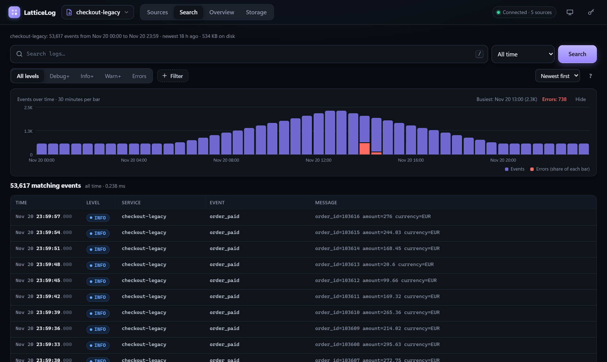
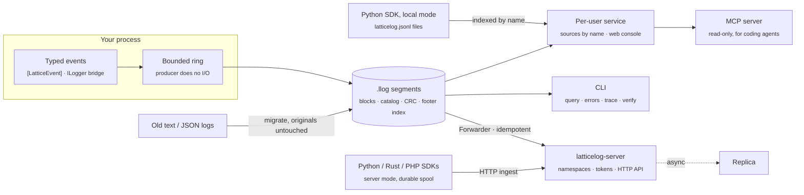

<div align="center">


<h1>LatticeLog</h1>

<p><strong>Typed, local-first logs for .NET, stored in an open binary format you can query by index<br>
and hand to people, scripts or coding agents (over MCP) as evidence that points back to every record.</strong></p>

[](https://github.com/lreyesm1999/LatticeLog/actions/workflows/ci.yml)
[](https://github.com/lreyesm1999/LatticeLog/releases)
[](global.json)
[](#project-status)
[](LICENSE)

<p>
  <a href="#quick-start">Quick start</a> ·
  <a href="docs/guides/getting-started.md">Tutorial</a> ·
  <a href="docs/guides/mcp.md">MCP setup</a> ·
  <a href="examples">Examples</a> ·
  <a href="docs/benchmarks.md">Benchmarks</a> ·
  <a href="docs/README.md">Docs</a>
</p>

</div>

---

## What it looks like

**The problem.** An order service fails intermittently. The logs are there, but finding *which* failures are the same
failure, and handing that to a teammate or a coding agent, means grepping text and pasting fragments.

**The implementation.** Events are declared once; a source generator writes the logging method at compile time, and
the attribute types (`long`, `int`, `string`…) are kept in storage:

```csharp
[LatticeEvent(Id = 2102, Name = "order.failed", Level = Severity.Error, Message = "Order {orderId} failed: {reason}")]
public static partial void OrderFailed(ILatticeLogger logger, long orderId, string reason, Exception? error);
```

**The result.** One command groups the failures deterministically and states what it covered: no sampling, nothing silently truncated. This is real
output from [`examples/dotnet-console`](examples/dotnet-console) (8,037 records, one injected incident), checked on every
CI run by [`scripts/check-examples.sh`](scripts/check-examples.sh):

```text
$ latticelog errors demo-store --format markdown          # excerpt; ids shortened with …
| coverage | value |
|---|---|
| matched_events | 16 |
| returned_events | 2 |
| truncated | False |
| partial_results | False |
| sampling | none |
| exhaustive | yes |

## Error groups (deterministic fingerprints, not root causes)

- `4971c8d6ee1067be` ×8 ERROR `order.failed` exception=`System.TimeoutException`, first llog://c17423fc…/e/196
- `a85a07c80de55c35` ×8 ERROR `inventory.stock.timeout`, first llog://c17423fc…/e/195

$ latticelog stats demo-store --by event                  # excerpt
order.received            2000
order.failed              8
-- total 8037 (from footer indexes, no block decoded)
```

Every `llog://` reference resolves to the original record (`latticelog event demo-store <ref>`). The same tools are
available to Claude Code, Cursor, Claude Desktop or VS Code as an [MCP server](docs/guides/mcp.md) that finds logs
**by service name**. LatticeLog runs no AI itself; it structures, filters and retrieves, and marks log text as untrusted
data.

<p align="center">
  <br>
  <sub>The local web console (<code>llog ui</code>) on <a href="docs/assets/screenshots/README.md">synthetic demo data</a>: a day of events, the incident's errors in red.</sub>
</p>

---

## Quick start

You need the [.NET 10 SDK](https://dotnet.microsoft.com/download) (exact version in [`global.json`](global.json)).
Packages are not on NuGet yet, so you build from source. About five minutes on a typical machine:

```bash
git clone https://github.com/lreyesm1999/LatticeLog.git
cd LatticeLog
dotnet build LatticeLog.sln -c Release

# 1. write ~8,000 events from a simulated order service with an injected incident
dotnet run -c Release --no-build --project examples/dotnet-console -- demo-store 2000

# 2. investigate it (alias the CLI to keep commands short)
alias latticelog="dotnet run -c Release --no-build --project src/LatticeLog.Cli --"   # PowerShell: see the tutorial
latticelog errors demo-store --top 3
latticelog query  demo-store --where "level >= ERROR" --limit 3 --explain
latticelog trace  demo-store --trace-id <id printed by step 1> --format markdown
```

The [tutorial](docs/guides/getting-started.md) walks through the same incident step by step, then connects your
coding agent. To install the CLI once as a single executable (no .NET, no administrator rights):

- **Windows, with a setup wizard:** download `latticelog-win-x64.msi` from the
  [releases](https://github.com/lreyesm1999/LatticeLog/releases) and run it. You pick the background service, PATH
  and which AI tools to connect; it appears in *Settings → Apps* for uninstalling. Releases after 0.1.0-alpha.7
  include it.
- **Or one line:** it downloads the newest release (Windows x64, Linux x64), checks it against `SHA256SUMS` and runs
  `latticelog setup`:

```powershell
irm https://raw.githubusercontent.com/lreyesm1999/LatticeLog/main/scripts/install.ps1 | iex   # Windows
```

```bash
curl -fsSL https://raw.githubusercontent.com/lreyesm1999/LatticeLog/main/scripts/install.sh | sh   # Linux
```

See [Install](docs/guides/install.md) for options, updates and uninstalling.

### Use it in your app

```xml
<ItemGroup>
  <ProjectReference Include="path/to/LatticeLog/src/LatticeLog.Core/LatticeLog.Core.csproj" />
  <ProjectReference Include="path/to/LatticeLog/src/LatticeLog.Generator/LatticeLog.Generator.csproj"
                    OutputItemType="Analyzer" ReferenceOutputAssembly="false" />
</ItemGroup>
```

```csharp
using var logger = LatticeLogger.CreateLocal("./logs", o => o.Resource.Add(new("service.name", "orders-api")));
logger.Info("Hello, LatticeLog");
```

Already on `ILogger`? Keep your code and add one line: `builder.Logging.AddLatticeLog(logger)`. The
[ASP.NET Core example](examples/aspnetcore) shows both side by side, with the request's trace id on every record.

| Guide | |
|---|---|
| [Getting started](docs/guides/getting-started.md) | The incident above, step by step, then your own app |
| [ASP.NET Core and `ILogger`](docs/guides/aspnetcore.md) | Minimal API, `[LoggerMessage]` and `[LatticeEvent]` side by side |
| [MCP: Claude Code, Cursor, Claude Desktop, VS Code](docs/guides/mcp.md) | One command per client, logs found by service name |
| [Investigating an incident with an agent](docs/guides/investigate-with-an-agent.md) | Which tools an agent calls, and what it gets back |
| [Migrating from text or JSON logs](docs/guides/migrating-from-text-logs.md) | Keep your files; convert them on request, losslessly where possible |
| [Python](sdks/python) · [Rust](sdks/rust) · [PHP](sdks/php) | Local folders (Python, Rust) and server shipping (Python, Rust, PHP) |
| [Troubleshooting](docs/guides/troubleshooting.md) | Common errors and what they mean |

---

## Why LatticeLog?

| If you need… | LatticeLog gives you | Evidence |
|---|---|---|
| Logging that stays off the hot path | Source-generated typed events: **56 ns, 5 B** per enabled event, **1.1 ns, 0 B** when the level is off | [hot path benchmark](reports/benchmarks-hotpath.md) (null sink, one machine) |
| To find the slice you need without decompressing everything | Time, severity, event and service indexes skip blocks; window queries **20–40×** faster than a full scan | [baseline §3](reports/baseline-v1.md#3-selective-queries-ms-median-of-3-segments--readtotal) |
| Smaller logs than compressed text, for typed events | **−25 %** vs. the same content as CSV + zstd-3 on 14 public Loghub-2.0 datasets (but **+17 %** vs. zstd-19) | [Loghub-2.0 report](reports/loghub2-v1.md) |
| Answers you can trust | Every response states its coverage (truncated? partial? sampled?) and links each item to its source record | [evidence protocol](specs/evidence-protocol.md) |
| Your coding agent to read logs safely | Read-only MCP server, sources by service name, log text marked as untrusted | [MCP guide](docs/guides/mcp.md) |
| No lock-in | Documented format, an independent Python reader that verifies golden files in CI, lossless export to JSONL or OTLP/JSON | [format spec](specs/llog-format-v0.md) · [`tools/pyllog`](tools/pyllog) |
| No infrastructure to start | Files in a folder; an optional per-user service and an optional single-node server | [install](docs/guides/install.md) · [server](docs/deploy/single-node.md) |

Where it does **not** win: storing raw, unstructured text is **+83 %** larger than zstd-3 (it keeps the exact bytes
and makes them queryable, not smaller), and zstd-19 beats it on size everywhere. Both are in the reports.

## How it compares

Different tools solve different layers. LatticeLog is a library **and** a storage/query engine, so it overlaps with
several of them partly and replaces none of them in general.

| | LatticeLog | Serilog / NLog | Seq | OpenTelemetry .NET | Grafana Loki |
|---|---|---|---|---|---|
| Category | Logging library + local store + query engine | Logging libraries | Log server with UI | Telemetry SDK and protocol | Log aggregation backend |
| Structured, typed attributes | Yes, types kept on disk | Structured properties; storage depends on the sink | Structured events (JSON) | Typed attributes on the wire (OTLP) | Labels indexed; line content as text |
| Compile-time generated log methods | `[LatticeEvent]` generator | Not built in (MEL's `[LoggerMessage]` works with both) | n/a | n/a | n/a |
| Storage and query included | Yes, local files | No (sinks write elsewhere) | Yes, server | No (exports to a backend) | Yes, server + object storage |
| Runs with no server | Yes | Yes | No | Yes (needs a backend to store) | No |
| Open on-disk format, independent reader | Yes | Depends on the sink (text and JSON files are open) | Server-internal storage | n/a (OTLP is an open wire format) | Server-internal storage |
| Access for coding agents (MCP) | Built in, read-only | Not built in | Community MCP servers (not from Datalust) | Not built in | Through Grafana's MCP server |
| Maturity | **Alpha**, one maintainer, no cluster | Mature, widely used | Mature commercial product | Stable, CNCF project | Mature, horizontally scalable |

LatticeLog already exports to OTLP/JSON and imports OTLP, so it can sit next to an OpenTelemetry pipeline rather than
replace it. A longer, sourced comparison is in [docs/comparison.md](docs/comparison.md).

---

## Benchmarks

All numbers come from **one machine** (Intel i9-14900KF, Windows 11, .NET 10.0.15, local SSD) and the reports say so.
That machine is unstable under all-core load, so concurrency runs were pinned to 4 CPUs. They are not a sizing guide.

| What | Result | Method | Reproduce |
|---|---|---|---|
| Enabled typed event, producer side | 55.6 ns, 5 B allocated | BenchmarkDotNet, null sink, 1 thread | [report](reports/benchmarks-hotpath.md) |
| Disabled event | 1.12 ns, 0 B | same | same |
| Typed events vs CSV+zstd-3 (Loghub-2.0) | −25 % total (−5 % to −58 %) | first 200k lines of 14 datasets | [report](reports/loghub2-v1.md) |
| `.llog` vs JSONL+zstd-3 (synthetic) | smaller on 7 of 8 workloads (−1.4 % to −23.4 %) | 100k records × 8 workloads | [report](reports/baseline-v1.md) |
| Server ingest, binary body | ~1.15 M records/s | 4 producers, loopback | [report](reports/ingest-v1.md) |
| Log call latency at a fixed rate | p50 0.1–0.3 µs, p99 ≤ 1.5 µs; **intermittent stalls of up to seconds** traced to that machine's nearly full SSD | real store, 10k–500k events/s, coordinated-omission-aware | [report](reports/latency-v1.md) |

Methodology, datasets, versions, raw CSVs and known limitations: **[docs/benchmarks.md](docs/benchmarks.md)**.
[`scripts/reproduce.sh`](scripts/reproduce.sh) reruns the tests, the baseline and the latency benchmark.

---

## Architecture



- **Local first.** The application never waits on the network to log. With a server configured, the local store is a
  durable outbox.
- **Honest acknowledgements.** `Fast`, `Balanced` or `Durable` (fsync); `FlushAsync` returns the level actually reached.
- **Exactly once at the server.** Every record carries `(producer, sequence)`, so retries are deduplicated.

Details: [features](docs/features.md) · [format spec](specs/llog-format-v0.md) · [architecture decisions](docs/decisions).

---

## Project status

**Alpha** (latest pre-release on [Releases](https://github.com/lreyesm1999/LatticeLog/releases)). 232 automated tests,
including real-process crash tests and end-to-end TLS, run in CI on Windows x64, Linux x64, Linux ARM64 and macOS ARM64.
Not production-hardened: the per-phase truth, including what did **not** pass, is in [`ROADMAP.md`](ROADMAP.md).

| Implemented | Experimental | Known limitations | On the [roadmap](ROADMAP.md) |
|---|---|---|---|
| .NET logger, generator, `ILogger` bridge | Lattice-C context encoding (opt-in) | No NuGet / PyPI / Packagist / crates.io packages | Published packages, stable release (later) |
| `.llog` 0.3 format, recovery, compaction, retention, backup | Async replication with manual failover | No encryption at rest, no external security review | Encryption at rest, external pentest (next) |
| CLI (also Native AOT), MCP server, per-user service | Web console (no browser E2E tests yet) | Benchmarks from one unstable machine | Measurements on stable hardware and Linux (next) |
| Python and Rust (local + server) and PHP (server) SDKs | Migration of text/JSON logs | No cluster or object storage | Cluster, object-storage tiers (later) |
| Single-node server: namespaces, tokens, audit, metrics | | Prebuilt executables for Windows x64 and Linux x64 only | Fuller console with user testing |

Changes: [`CHANGELOG.md`](CHANGELOG.md).

## Contributing

Issues and pull requests are welcome; [`CONTRIBUTING.md`](CONTRIBUTING.md) explains the local setup, the tests and
where to start. Questions go to [`SUPPORT.md`](SUPPORT.md), vulnerabilities to [`SECURITY.md`](SECURITY.md) (privately).
Participation follows the [Code of Conduct](CODE_OF_CONDUCT.md).

## License

[MIT](LICENSE).
