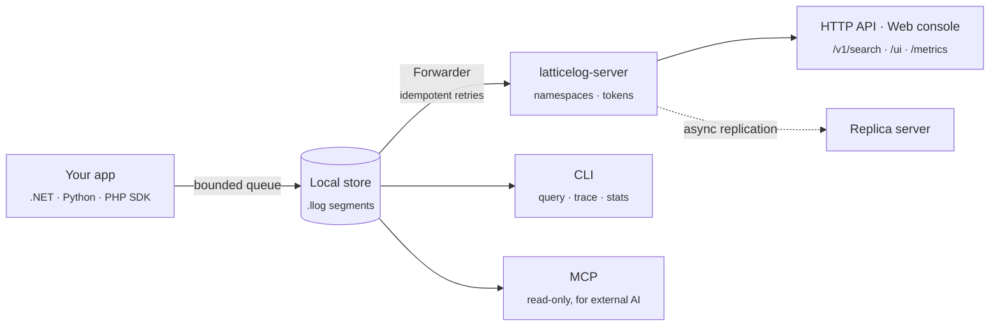

<div align="center">


<h1>LatticeLog</h1>

<p><strong>Typed, local-first logs in an open binary format. Read only what you need, and hand over evidence anyone can verify.</strong></p>

[](https://github.com/lreyesm1999/LatticeLog/actions/workflows/ci.yml)
[](https://dotnet.microsoft.com/)
[](sdks/python)
[](sdks/php)
[](ROADMAP.md)
[](LICENSE)

<p>
  <a href="#quick-start">Quick Start</a> ·
  <a href="#how-it-works">How It Works</a> ·
  <a href="#capabilities">Capabilities</a> ·
  <a href="#measured-results">Results</a> ·
  <a href="#project-status">Status</a> ·
  <a href="#documentation">Docs</a>
</p>

</div>

---

**LatticeLog** is a log and event engine for .NET 10. Your application writes **typed events** with very low overhead. They go to an **open binary format (`.llog`)** on local disk that rebuilds every event exactly as it was written. Queries use **indexes** to skip everything they don't need, and the engine produces **deterministic evidence** for whoever reads next: a person, a script or an external AI.

> [!NOTE]
> **LatticeLog runs no AI.** It structures, filters, groups and retrieves. Interpreting the result is up to the reader, and every answer points back to the exact records it came from.

<table>
  <tr>
    <td width="33%"><strong>1. Capture with types</strong><br>Events declared once, generated at compile time. A <code>long</code> stays a <code>long</code>. 56 ns per event on the hot path.</td>
    <td width="33%"><strong>2. Store in the open</strong><br>Append-only <code>.llog</code> segments with per-block CRCs, crash recovery, and an independent Python reader that proves the spec.</td>
    <td width="33%"><strong>3. Read precisely</strong><br>Indexes skip blocks that cannot match. Every answer says what it covered and whether anything is missing.</td>
  </tr>
</table>

---

## The Problem It Solves

| Plain-text / JSON logs | LatticeLog |
|---|---|
| `42`, `"42"` and `42.0` all end up as text; searching means `grep` and regexes. | Every attribute keeps its type: `long`, `decimal`, UUID, timestamp, bytes, maps. |
| The same JSON keys are repeated millions of times; filtering one hour of errors means decompressing and parsing everything. | Columnar blocks with a key catalog; time/severity/service/trace indexes skip whole blocks. |
| Results are silently truncated, sampled or incomplete. | Each response states its **coverage**: segments scanned, partial or not and why, storage issues found. |
| Handing context to a teammate or an AI means copy-pasting fragments. | **Context Packs** and a **read-only MCP server** with references back to every source record. |
| Retries can duplicate or lose data. | Each record carries `(producer, sequence)`: retries are idempotent, and an ACK reports the durability actually reached. |
| Your data is locked into a vendor's storage. | Documented format, independent reader, and a lossless export to `latticelog.jsonl` or OTLP. |

---

## Quick Start

> Packages are not on NuGet/PyPI/Packagist yet. Clone the repository and reference the projects directly. You need the [.NET 10 SDK](https://dotnet.microsoft.com/download).

```bash
git clone https://github.com/lreyesm1999/LatticeLog.git
cd LatticeLog
dotnet build LatticeLog.sln -c Release
```

### 1. Write your first event

```xml
<!-- YourApp.csproj -->
<ProjectReference Include="path/to/LatticeLog/src/LatticeLog.Core/LatticeLog.Core.csproj" />
```

```csharp
using LatticeLog;
using LatticeLog.Core;

using var logger = LatticeLogger.CreateLocal("./logs");
logger.Info("Hola mundo");
```

### 2. Read it back

The `.llog` file is binary, so you read it through a tool rather than a text editor. The CLI is the quickest:

```bash
dotnet run --project src/LatticeLog.Cli -- tail ./logs
```

```text
2026-11-18T23:43:10.289692300Z INFO  Hola mundo #1
```

```bash
dotnet run --project src/LatticeLog.Cli -- query ./logs --where "level >= INFO"
```

```text
2026-11-18T23:43:10.289692300Z INFO  Hola mundo #1
-- 1 event(s); scanned 1/1 segments, 1 records decoded in 14 ms
```

### 3. Go typed

Declare an event once. A Roslyn source generator writes the method at compile time, so there is no reflection and no string formatting on the hot path:

```csharp
using var logger = LatticeLogger.CreateLocal("./logs", o =>
{
    o.Durability = DurabilityMode.Balanced;              // Fast | Balanced | Durable
    o.Resource.Add(new("service.name", "orders-api"));
});

using (logger.BeginOperation("PlaceOrder", "order-991"))
    AppEvents.StockTimeout(logger, productId: 42, elapsedMs: 12_000);

await logger.FlushAsync(AckLevel.FsyncConfirmed);        // returns the level actually reached

static partial class AppEvents
{
    [LatticeEvent(Id = 2101, Name = "inventory.stock.timeout", Level = Severity.Error,
                  Message = "Stock query for {productId} timed out after {elapsedMs} ms")]
    public static partial void StockTimeout(ILatticeLogger logger, long productId, int elapsedMs);
}
```

Already using `ILogger`? The `LatticeLog.Extensions.Logging` bridge lets you keep your existing code. A complete workload with an injected incident lives in [`examples/dotnet-console`](examples/dotnet-console).

---

## How It Works



- **Local first.** The application never waits on the network to log. With a server configured, the local store doubles as a durable outbox: if the network or server is down, records wait on disk.
- **Exactly once at the server.** Every record has a `(producer, sequence)` pair. The server deduplicates and rebuilds that state from its own data after a crash, so a retry is always safe.
- **Honest acknowledgements.** `Fast`, `Balanced` or `Durable` (fsync). `FlushAsync` returns the level that was *actually* reached, never the one you hoped for.

---

## Capabilities

<details open>
<summary><strong>Capture: SDKs</strong></summary>

| | .NET | Python | PHP |
|---|---|---|---|
| Typed events | Source-generated (`[LatticeEvent]`, diagnostics LL0001–LL0007) | Typed values (`int` → Int64/UInt64, `Decimal`, `UUID`, `datetime`…) | Typed values |
| Integration | `ILogger` bridge, `Activity` / trace context | `logging.Handler` | Scopes and operations |
| Storage | Writes `.llog` directly | Durable JSONL spool | Spool shared across PHP processes (`flock`) |
| Shipping | `Forwarder` (binary body, falls back to JSONL) | Background thread, backoff + jitter | At request end, after `fastcgi_finish_request` |

</details>

<details>
<summary><strong>Storage: the <code>.llog</code> format</strong></summary>

- Append-only **segments** of **blocks**; a segment is sealed when it grows and is immutable afterwards.
- **Lattice-S** codec: keys, names and templates go to a catalog; values are grouped by field, then compressed.
- **Integrity**: CRC per block; after a power cut, everything valid is recovered and the torn segment is sealed.
- **Open**: normative spec in [`specs/`](specs) and an [independent Python reader](tools/pyllog) that verifies frozen golden files on every test run.
- Online **compaction**, **retention** by age or size, verified **hot backup**.

</details>

<details>
<summary><strong>Query and evidence</strong></summary>

```bash
latticelog query   ./logs --where "level >= ERROR AND service = 'orders-api'" --since 1h --explain
latticelog trace   ./logs --trace-id 4bf92f3577b34da6a3ce929d0e0e4736 --format markdown
latticelog stats   ./logs --by event --bucket 1m
latticelog errors  ./logs --since 24h --top 10
latticelog context ./logs --where "level >= WARN" --budget-bytes 32000 --format json
latticelog export  ./logs --format llog-jsonl --output logs.jsonl
latticelog mcp     ./logs                       # read-only MCP server over stdio
```

- A small [query language](specs/query-language.md) with fields, attributes (`attr.name`), time ranges and traces.
- **Context Packs**: error groups, traces and samples within a byte budget, each with an `llog://` reference to the original record.
- **Untrusted-content marking**: evidence lists which fields contain text copied from logs, so downstream tools treat it as data.

</details>

<details>
<summary><strong>Server: <code>latticelog-server</code></strong></summary>

| Area | What you get |
|---|---|
| Multi-tenant | Namespaces `tenant/project/env`, each with an isolated store |
| Access | Hashed bearer tokens with `ingest` / `read` / `admin` scopes per namespace; hot reload; brute-force brake |
| Read API | Search with HMAC-signed, expiring cursors · events · traces · stats · context packs · lossless export · catalog ([spec](specs/server-api.md)) |
| Online admin | Retention, compaction, verification, privacy erasure, hot backup, all without stopping ingestion and all audited |
| Operations | Prometheus `/metrics`, audit log, web console at `/ui` (strict CSP, log text rendered as text only) |
| Replication | Asynchronous primary → replica, with manual failover and no duplicates |
| Ingestion | Binary or JSONL bodies, group commit, quotas, bounded queues, TLS required off loopback |

```bash
dotnet run --project src/LatticeLog.ServerHost -- hash-token "<secret>"   # put the hash in tokens.json
dotnet run --project src/LatticeLog.ServerHost -- --data ./server-data --tokens tokens.json
# → http://127.0.0.1:7400/ui  ·  /v1/search  ·  /metrics
```

See the [single-node deployment guide](docs/deploy/single-node.md), the [operations runbook](docs/operations/runbook.md) and the [replication guide](docs/operations/replication.md).

</details>

---

## Measured Results

<table>
  <tr>
    <td align="center" width="25%"><h3>56 ns</h3>per typed event on the .NET hot path<br><sub>5 B allocated · 1.1 ns / 0 B when the level is off</sub></td>
    <td align="center" width="25%"><h3>−25 %</h3>size vs. the same content in CSV + zstd-3<br><sub>14 public datasets (Loghub-2.0)</sub></td>
    <td align="center" width="25%"><h3>20–40×</h3>faster time/severity window queries<br><sub>vs. a full scan</sub></td>
    <td align="center" width="25%"><h3>1.15 M/s</h3>records ingested by the server<br><sub>4 producers, binary body</sub></td>
  </tr>
</table>

> [!IMPORTANT]
> All figures come from **one machine** (Windows x64, i9-14900KF), and concurrency runs were pinned to 4 CPUs because that machine is unstable under all-core load. They are not a sizing guide. Where LatticeLog loses, it is reported too: zstd-19 (about 100× slower) is smaller on every dataset, and the aspirational −30 % vs. JSONL+zstd was not reached. Methodology and raw numbers are in [`reports/`](reports).

---

## Project Status

**`0.1.0-alpha.1`**: functional and tested locally (135 automated tests, including real-process crash tests, lossy networks and server restarts). Not production-hardened yet.

| Works today | Not yet |
|---|---|
| Local engine, CLI, MCP adapter | Cluster / sharding, object-storage tiers |
| Single-node server with online admin, audit, metrics, console | Encryption at rest, external security review |
| Async replication with manual failover | CI on Linux/macOS (the workflow is new) |
| .NET, Python and PHP SDKs | Published packages (NuGet, PyPI, Packagist) |

The per-phase truth, including what did **not** pass, is in [`ROADMAP.md`](ROADMAP.md) and [`docs/decisions/`](docs/decisions).

---

## Repository Layout

```text
src/
  LatticeLog.Abstractions     event model and public API
  LatticeLog.Core             logger: bounded queue, durability modes, scopes, redaction
  LatticeLog.Generator        Roslyn source generator for typed events
  LatticeLog.Storage          .llog format, codecs, writer/reader, recovery, compaction, retention, backup
  LatticeLog.Query            query language, index-aware planner, cursors, aggregations
  LatticeLog.Evidence         context packs and evidence documents
  LatticeLog.Ingest           remote ingestion protocol, client and Forwarder
  LatticeLog.Server(Host)     latticelog-server
  LatticeLog.Cli              latticelog CLI (also a dotnet tool, trimming/AOT-ready)
  LatticeLog.Mcp              read-only MCP server
  LatticeLog.OpenTelemetry    OTLP/JSON and importers
  LatticeLog.Extensions.Logging   Microsoft.Extensions.Logging bridge
sdks/python  sdks/php        SDKs for other languages
specs/                       normative specs (format, ingest protocol, server API, query language)
tools/pyllog                 independent Python reader of the format
tests/  benchmarks/  research/  reports/
```

---

## Documentation

Specs are in English. Product, operations and design docs are currently in **Spanish**.

| Topic | Where |
|---|---|
| Format, protocol, server API, query language | [`specs/`](specs) |
| Deploying a single node | [`docs/deploy/single-node.md`](docs/deploy/single-node.md) |
| Operations, SLIs, alerts, backup, runbooks | [`docs/operations/runbook.md`](docs/operations/runbook.md) |
| Replication and failover | [`docs/operations/replication.md`](docs/operations/replication.md) |
| Compatibility and versioning | [`docs/compatibility.md`](docs/compatibility.md) |
| Threat model | [`docs/security/threat-model.md`](docs/security/threat-model.md) |
| Architecture decisions and phase reviews | [`docs/decisions/`](docs/decisions) |
| Benchmarks and experiments | [`reports/`](reports) |
| Python / PHP SDKs | [`sdks/python`](sdks/python) · [`sdks/php`](sdks/php) |

---

## Development

```bash
dotnet build LatticeLog.sln -c Release
dotnet test  LatticeLog.sln -c Release
python -I tools/pyllog/llog.py verify-golden tests/GoldenFiles/v0.1 tests/GoldenFiles/v0.2
```

Requires the .NET SDK pinned in [`global.json`](global.json) and Python 3.10+ for the reference reader. The SDK tests run when `python` and `php` are on the `PATH` and are skipped otherwise.

## Contributing

Issues and pull requests are welcome. Read [`CONTRIBUTING.md`](CONTRIBUTING.md) first. Format changes need a spec update, new golden files and a pass of the independent reader. Report vulnerabilities privately as described in [`SECURITY.md`](SECURITY.md).

## License

[MIT](LICENSE). Free to use, modify and redistribute.
